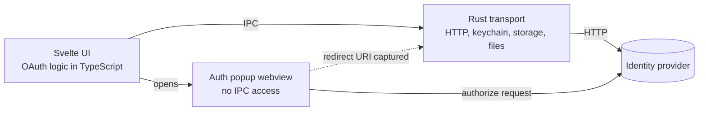

<div align="center">


# OIDC Tester


Desktop app for testing OAuth 2.0 / OpenID Connect flows against any identity provider, with any redirect URI.

[Features](#features) · [Getting started](#getting-started) · [Usage](#usage) · [Development](#development)

</div>

## Overview

OIDC Tester runs OAuth 2.0 / OIDC flows against any IdP using an arbitrary (spoofed) redirect URI. The redirect never has to resolve: an internal popup webview intercepts the navigation to the redirect URI and captures the code or tokens from it.

> [!NOTE]
> Windows only. The app relies on WebView2.

> [!WARNING]
> This app was developed with spec-driven AI coding: requirements are written first in [`specs/`](specs/README.md), and an AI coding assistant implements the code and tests against them. Review the code before relying on it, and do not use it with production credentials.

## Features

- Discovery autofill from the issuer (`.well-known/openid-configuration`).
- Standard flows: authorization code (with PKCE), implicit, hybrid, client credentials, password, refresh token and device code, plus a UserInfo call.
- Per-IdP HTTP settings: custom headers for back-channel calls, CORS origin simulation, TLS validation off, proxy.
- Extra query parameters on the authorize request; response modes `query`, `fragment` or default.
- Error display for authorize and token responses, including non-JSON bodies.
- JWT decoder in the style of jwt.io, with signature verification and ID-token validation.
- Request timeline with HAR and cURL export.
- Autosaved scratchpad that can be saved as named workspaces (Workspace → IdP → Client → Flow).
- Client secrets stored in the OS keychain.
- Light, dark or system theme.

## Getting started

Prerequisites:

- Windows 10/11 with WebView2
- Node.js 24
- [pnpm](https://pnpm.io)
- Rust stable (if `cargo` is not found, add `%USERPROFILE%\.cargo\bin` to `PATH`)

```sh
git clone https://github.com/frapetti-dev/oidc-tester
cd oidc-tester
pnpm install
pnpm dev     # runs `tauri dev`
pnpm build   # packages the app via `tauri build`
```

> [!IMPORTANT]
> Use pnpm only. npm, yarn and bun are not supported.

## Usage

1. Create an IdP and enter its issuer; discovery fills in the endpoints.
2. Add a client with its `client_id` and authentication method. The secret is stored in the keychain.
3. Add a flow under the client and set any redirect URI, resolvable or not.
4. Run the flow. For interactive flows an auth popup opens and is closed once the redirect is intercepted.
5. Inspect the tokens in the decoder and the requests in the timeline.
6. Export the timeline as HAR or individual requests as cURL.

> [!TIP]
> `pnpm mock-idp` starts a local IdP on http `:4455` and https `:4456` to try the app out.

> [!WARNING]
> Disabling TLS validation is for testing only.

## How it works

All OAuth logic is pure TypeScript. Rust is a thin transport layer.



## Development

| Command                | Purpose                                                                            |
| ---------------------- | ---------------------------------------------------------------------------------- |
| `pnpm dev`             | Run the desktop app (`tauri dev`)                                                  |
| `pnpm build`           | Package the desktop app (`tauri build`)                                            |
| `pnpm vite:dev`        | Vite dev server only (port 5173)                                                   |
| `pnpm check`           | `svelte-check`                                                                     |
| `pnpm lint`            | Prettier check + ESLint                                                            |
| `pnpm format`          | Prettier write                                                                     |
| `pnpm test`            | `test:unit` + `test:rust` + `spec:check`                                           |
| `pnpm test:unit`       | Vitest (server, browser and Storybook projects)                                    |
| `pnpm test:rust`       | `cargo test` for `src-tauri`                                                       |
| `pnpm test:e2e:web`    | Playwright against the web build with mocked IPC                                   |
| `pnpm test:e2e:native` | Playwright against the real app over CDP (`E2E_SKIP_BUILD=1` reuses the debug exe) |
| `pnpm mock-idp`        | Local mock IdP on http `:4455` and https `:4456`                                   |
| `pnpm spec:check`      | Every Accepted requirement must be referenced by a test                            |
| `pnpm storybook`       | Storybook on port 6006                                                             |

Development is spec-driven: requirements with `REQ-<AREA>-NNN` IDs live in [`specs/`](specs/README.md), and every Accepted requirement must be referenced by a test. See also [`docs/ui-design.md`](docs/ui-design.md), [`docs/adr/`](docs/adr/) and [`AGENTS.md`](AGENTS.md).

## Project structure

```
specs/                  Requirements (REQ IDs), source of truth
docs/                   UI design reference, ADRs
scripts/                Spec coverage check
src/routes/             SPA shell
src/lib/components/     ui/, shell/, app/, editors, panels
src/lib/oauth/          Discovery, PKCE, authorize, callback, client auth, tokens, device, CORS
src/lib/jwt/            Decode, verify, ID-token validation, claims
src/lib/run/            Per-flow run engine
src/lib/export/         cURL and HAR export
src/lib/model/          zod schemas and factories
src/lib/state/          Rune-based state classes
src/lib/ipc/            Typed wrappers over Tauri commands
src-tauri/src/          Rust transport (http, auth_window, secrets, storage, files)
tests/                  Mock IdP, integration tests
e2e/                    Playwright journeys (web, native)
```
